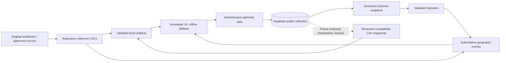

# Backend architecture and data ownership

This is the entry point for maintaining the backend after the November 2026 audit. Read this alongside [AGENTS.md](../AGENTS.md), [the visit-history reference](VISIT_HISTORY.md), [Supabase operations](supabase.md) and [future repository checkpoints](REPO_CHECKPOINTS.md).

The release's data-preservation evidence and regression coverage are recorded in [BACKEND_VERIFICATION.md](BACKEND_VERIFICATION.md).

## Decisions and implemented boundaries

1. Repository reference CSVs supply immediate rendering and authoritative country geography. The original uploaded workbook remains immutable source evidence. Builds validate CSVs and generate ignored `src/generated/` artifacts; the browser never parses Excel.
2. Supabase persists authenticated collection edits. A CSV fallback is not permission to overwrite a newer saved value. Reference refreshes preserve editable state; scoped corrections use guarded transactions.
3. Eight concise physical tables in `atlas_data` store each fact once. The established public table names are invoker-secured API views that reconstruct exactly the same records. Existing identities, column permissions and RPCs remain compatible. See [CONCISE_STORAGE.md](CONCISE_STORAGE.md).
4. A versioned collection RPC reads the eight public business tables at one database snapshot. Concurrent frontend readers share its in-flight request. Unchanged results do not replace React state unnecessarily.
5. Periodic database-to-repository writeback is **future work**, as requested. There is no exporter, scheduler, automatic commit or writeback workflow in this change.
6. Territories, favourites, travel intentions, expanded places, visa status and map creation are design constraints below. Their product features and placeholder tables are not implemented here.

The physical tables have now been normalized. City country labels/geography, viewer URLs, counted city visit aggregates and period-backed country visit aggregates are reconstructed rather than copied. Independent lifetime figures, unknown/partial dates and genuine manual overrides remain stored. Public API views are projections, not another maintained copy of the data. Import operators use view-compatible inserts/updates and preserve their previous validation and transaction behavior.

The migration also enforces the previously missing city-to-country foreign key. It is deferred until transaction commit, so a controlled import can insert a city before its parent country within the same transaction; null country codes remain supported. Invalid references cannot become committed orphan records.

## Audit inventory

The live audit checked columns, keys, constraints, indexes, functions, triggers, grants, row-level security and CSV agreement, not just file names. At the audited baseline:

| Table                   | Rows | Responsibility                               |
| ----------------------- | ---: | -------------------------------------------- |
| `cities`                |  343 | City catalog and current collection state    |
| `city_visits`           |  222 | Counted city visits                          |
| `city_visit_periods`    |  235 | Actual city stays, including explicit halves |
| `countries`             |  198 | Country/profile catalog and collection state |
| `country_visits`        |  127 | Independent counted country visits           |
| `country_visit_periods` |  140 | Actual country stays and provenance          |
| `places`                |    1 | Place catalog, geometry and collection state |
| `place_countries`       |    2 | Many-to-many place/country membership        |
| `atlas_private.editors` |    1 | Explicit editor allowlist; never public      |

All eight public business tables had RLS enabled. Public readers could execute the three existing read RPCs; editor checks and atomic status imports remained authenticated-only. All city country codes resolved. City records totalled 401 recorded days; country records totalled 314.5 recorded days. These are audit snapshots, not hard-coded product totals or a claim that country histories are complete.

The review identified full-row database hydration overriding newer static classifications, three independent polling requests, redundant unchanged-state replacement, a place upsert that could reset online edits, and verification split between city/country and place commands. There was no automatic database-to-repository export. Existing history validation, half-day storage, optimistic concurrency and RLS are retained.

## Ownership by field

“Static” means published reference material, not that its contents can never receive an approved correction. Editable catalog metadata is distinct from travel facts and map progress.

| Data                                              | Authority                                       | Repository representation                                                          | Database role                                                                                            |
| ------------------------------------------------- | ----------------------------------------------- | ---------------------------------------------------------------------------------- | -------------------------------------------------------------------------------------------------------- |
| Country/city country hierarchy                    | Owner's categorization workbook                 | `data/reference/country-geography.csv` plus raw workbook and provenance            | Existing city geography synchronized for compatibility; stale DB geography cannot override the reference |
| Country reference figures, indices, median pools  | Approved metric workbook/model                  | `country-metrics.csv`, `country-metric-medians.csv`, comparison-region override    | No runtime recalculation or editable copy                                                                |
| Highlights and source attribution                 | Reviewed published reference                    | `country-highlights.csv`, source metadata                                          | Not user preference state                                                                                |
| City identity, reviewed position, country code    | Reviewed catalog                                | `cities.csv`, coordinate sidecar, immutable source batches                         | Current catalog columns; controlled metadata refresh                                                     |
| Country names, codes, aliases, set membership     | Reviewed catalog                                | `countries.csv` for membership/state; geography and label reference CSVs for names | Current catalog columns; independent of visit history                                                    |
| Place identity, outline, country associations     | Reviewed catalog                                | `places.csv`, `place-countries.csv`, outline artifact/source                       | Current place catalog and relation tables                                                                |
| Map URLs, progress, notes, pin colour             | Editable collection/catalog state               | Current compatibility CSV fallback; future reviewed checkpoints                    | Confirmed database save is live authority; imports preserve it                                           |
| Actual stays and explicit durations               | Owner's travel records                          | Stay-period CSVs and approved source evidence                                      | Independent city/country period tables                                                                   |
| Counted visits                                    | Grouped travel records with existing validation | Visit-history CSVs                                                                 | Parent visit tables, validated against actual periods                                                    |
| Supplied lifetime country totals and completeness | Owner-supplied facts                            | Country overview CSV                                                               | Never inferred from an incomplete history                                                                |
| Auth users, editor grants, sessions, secrets      | Supabase Auth / operator configuration          | No public CSV                                                                      | Private; excluded from public snapshots and future exports                                               |

Canonical CSVs omit repeated labels, geography and calculated history summaries. The established exchange format is reconstructed by `scripts/collection-inputs.ts` and is not maintained as a second source. New reference data belongs under `data/reference/`; original evidence belongs under `data/sources/`. A future checkpoint format must separate editable snapshots explicitly and retain legacy CSVs only as generated compatibility projections.

Map status, historical visit status, intended future travel and favourites must remain separate concepts. Changing one must not implicitly change the others.

## Authoritative geography

Source: `data/sources/country-geography/countries_categorization.xlsx`. The literal worksheet contains exactly 197 unique country codes and matches the names/codes of the 197-row country overview. The derived CSV stores `CountryCode,Country,Continent,Region,Subregion`.

- Use the owner's labels verbatim; do not replace them with UN/ISO/provider conventions.
- Empty cells are authoritative empty values. In particular, all twelve South American countries have blank Region/Subregion; do not retain stale city regions or infer replacements.
- Apply classification to both countries and their cities by country code, not display-name matching.
- Svalbard's existing `SJ` profile is outside the workbook. Preserve its existing continent and do not invent its missing hierarchy.
- Keep the 197-row source and 198-profile fallback distinction explicit. Do not add or remove countries merely to make the counts equal.
- The metric workbook's comparison groups are a separate statistical contract. Do not recalculate metric medians or change the Turkey comparison override when changing profile geography.
- The runtime reapplies the authoritative hierarchy after database hydration, preventing a stale response from reverting it.

`country:prepare-geography` derives the authoritative reference CSV. `country:verify-geography` checks reproducibility without rewriting them. The live geography command updates the shared country classification and affected city revisions under a guarded transaction; all other business fields and relationships must remain equal. No visit is regrouped because its region label changed.

## Runtime and database contracts



`atlas_collection_snapshot()` is a STABLE, SECURITY INVOKER SQL function with an empty search path. One SQL statement returns:

```json
{
  "version": 1,
  "cities": { "cities": [], "visits": [], "periods": [] },
  "countries": { "countries": [], "visits": [], "periods": [] },
  "places": []
}
```

The arrays above illustrate shape, not a valid empty production collection. Each nested object retains the existing legacy reader's validation and representation. Place snapshots include their country associations. Nested STABLE reads share the statement's MVCC snapshot, so a capture cannot combine a pre-save city read with a post-save country read. Future private fields must never be included automatically.

The frontend shares an in-flight request by Supabase client. There is no stale time-to-live response cache: an explicit refresh can obtain current database state. Existing hooks keep their focus/visibility/30-second behavior. Optimistic write-version guards, pending saves, revisions and error messages remain effective. Snapshot fingerprints include operational revisions needed for conflict detection. A legacy-reader fallback is allowed only when the new function is absent, not for network, authorization or malformed-response errors.

Confirmed saves/imports and failed write attempts invalidate shared read reuse. A post-write refresh starts a fresh request instead of joining another hook's pre-write request; an older request retains isolated reader state. Place status saves now use the revision that produced the displayed record, matching city save semantics, so a concurrent edit is rejected rather than overwritten. Revision-only refreshes still update the next save's concurrency token without forcing a visible redraw.

The six unused catalog/state projections from the initial compatibility stage were removed. The eight existing public relation names now adapt the concise tables to the original API. Reads use invoker security; writes retain the editor allowlist, original column grants, optimistic revisions and deferred summary validation. Country/city history remains independent.

This iteration reduces duplicate concurrent requests and unchanged UI work. The unified response still contains legacy catalog fields; it does **not** claim a smaller total payload. A future revision can send immutable catalog identifiers/hashes plus narrow state after all consumers support that contract. Do not remove geometry/catalog fields from version 1 or silently change its meaning.

## Import safety and operations

Place metadata refreshes now preserve saved URLs, map/visit state, dates, notes and pin colour. A no-op metadata refresh preserves `updated_at`; a changed reference updates that revision. Strict place verification still reports divergence from the repository snapshot. Reference-only apply verification does not mistake deliberately preserved edits for a failed transaction.

Existing preparation ledgers are provenance, not permission to reset later online changes. Before replaying a historical batch, use its guarded comparison; if the database differs unexpectedly, stop and review the difference. Synchronization is not a general last-writer-wins overwrite.

```sh
npm run country:verify-geography
npm run architecture:verify          # inspect/validate; no committed writes
npm run country:verify-geography-live
npm run data:verify-live             # existing six city/country tables
npm run places:verify-live           # both place tables; also required
```

Apply commands are explicit: `architecture:apply` installs the additive schema with before/after business-data equality; `country:apply-geography` applies only the approved classification delta. Operator credentials remain server-side environment variables. `.cache/` reports are ignored and must not expose credentials or sessions. Neither command enables repository writeback or adds future-feature data.

All public record shapes, RPCs and supported editor permissions are preserved by the concise-storage migration; redundant physical columns and the superseded maintained aggregate CSV were removed. Keep old readers available through deployment/rollback overlap. A client rollback can continue reading the old APIs after the additive migration. Reverting application code does not require reverting approved geography data.

## Future entity model

The following is the target design, **not implemented features**. Migrate behind existing adapters with explicit data/permission tests when each feature is requested.

| Concern                | Required model                                                                                                                                    | Compatibility rule                                                                                                                       |
| ---------------------- | ------------------------------------------------------------------------------------------------------------------------------------------------- | ---------------------------------------------------------------------------------------------------------------------------------------- |
| States and territories | Stable geographic entities with kind, explicit set membership, and typed many-to-many administering/sovereignty relations, optionally date-ranged | Preserve existing 195/197 counts and routes; a territory does not automatically become a UN member or inherit its parent's visited state |
| Svalbard identity      | Explicit profile entity and aliases to legacy `SJ` route; distinguish combined ISO source rows                                                    | Never apply Svalbard/Jan Mayen combined metrics to Svalbard alone or silently repurpose an existing key                                  |
| Favourites             | Independent city/country preference in an explicit owner/collection scope                                                                         | Can coexist with visited, planned or wanted; does not affect map progress or visit counts                                                |
| Planned / Want         | Separate travel intention, with optional plans/target dates later                                                                                 | Historical `visited` remains a fact; preserve current legacy `planned` reads until a deliberate migration                                |
| Expanded places        | `place_countries` plus independent `place_cities` many-to-many relations                                                                          | A city can belong to multiple places; membership does not duplicate city totals or create visits                                         |
| Visa status            | Traveller/passport-specific private records, with validity/destination context; policy reference data separate                                    | No visa or passport details in public collection snapshots, CSV fallback or public GitHub checkpoints                                    |
| Create City Map        | Map definition/provider identifiers, links, and creation-job state separate from geography and visits                                             | Keep existing URLs working; verify provider creation capabilities before promising automation; credentials stay server-side              |

Do not pack these into `notes`, map statuses, pin colours or one overloaded enum. Do not add nullable feature placeholders throughout legacy tables. Use foreign keys and explicit uniqueness rules; model many-to-many relations as relations rather than delimited text. Stable IDs survive renames and caption abbreviations.

The current single-editor public atlas is not automatically a multi-user travel service. A future owner/collection model must specify public collection visibility and private user preferences separately, with RLS tests for another authenticated user's denial. A future visa feature needs that privacy boundary before data entry.

## Parity requirements and verification

The approved functional delta is replacement of country/city classifications. Everything else must retain observable behavior, including:

- All IDs, record counts, map URLs/coordinates, notes, map statuses and editor grants.
- Independent country and city histories, unknown dates/totals, six-/fourteen-day grouping, actual disconnected stays and explicit half-days.
- Country sets, visited-order ranks, scoreboard totals and place exclusion from city statistics.
- Search, filters, sorting, tabs, navigation, URL reloads, pin targets, selection outlines and lazy map viewer.
- The complete approved visit-history solver, city captions, capsule/dash geometry, marker exceptions, row heights and mobile typography.
- Authentication, anonymous/unauthorized denials, optimistic concurrency, atomic import, sign-out, recovery and offline fallback.

Use real PostgreSQL semantics in PGlite for migration equality, view permissions, RLS, preservation and rollback. Test both the new unified reader and the missing-function legacy path; malformed versions and genuine failures must not silently fall back. Validate all workbook codes and city mappings, blank clearing, Svalbard fallback, and stale-database overrides.

Run the full unit suite, production build, existing collection browser suite and cloud-auth browser suite for this cross-cutting change. Use one browser worker for software-rendered WebGL to avoid resource-contention timeouts. Add responsive classification checks and verify the deployed commit, production alias, public RPC and all-table data agreement after release. Existing external Google/provider network limitations are not resolved by a data architecture change; test the app's canonical URLs and navigation separately.

For periodic writeback requirements, conflict handling and explicit publication boundaries, use [REPO_CHECKPOINTS.md](REPO_CHECKPOINTS.md). That design remains inactive until requested.
