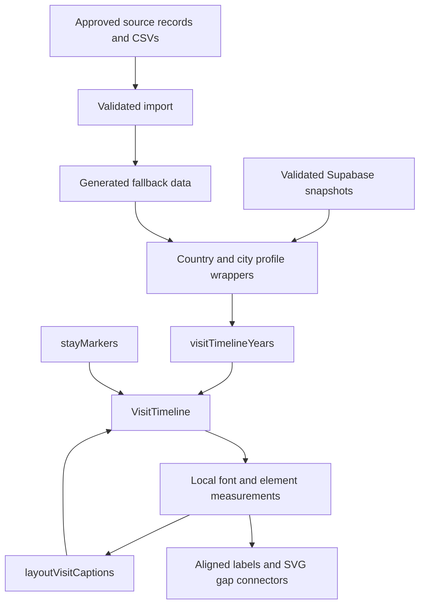

# Visit history: implementation and maintenance reference

This is the starting point for understanding the country and city visit-history sections in a new development context. It covers the data contract, presentation rules, caption solver, browser measurements, styles and verification.

**Approved timeline/caption baseline:** 16 November 2026, implementation commit [`a61343f`](https://github.com/MelvinLecoy/MyMap/commit/a61343ffcd107f8cf3e38972c1c67974d349b832). The owner accepted the resulting timeline presentation. The country history header was subsequently restyled as described below. Stored visits will receive further corrections and additions; the current records and audit counts are snapshots, not a frozen or complete travel history.

Read [AGENTS.md](../AGENTS.md) alongside this guide. [VISIT_HISTORY_MARKERS.md](VISIT_HISTORY_MARKERS.md) is the focused marker-policy reference. The older [city history](city-history.md), [country history](country-history.md) and [duration updates](duration-updates.md) documents contain source, database and migration details, including historical counts and rollout notes.

## 1. Rules to preserve

- A **counted visit** can contain several **actual stays**. Preserve both levels. Gaps between stays never add days.
- City grouping uses a six-day threshold; country grouping uses fourteen days. Rendering never regroups stored visits.
- Years and counted visits display newest first. Actual stays within a visit display earliest first.
- Each counted visit has one shared month heading, one total and its own independently sized row. A tall visit must not stretch ordinary rows.
- A stacked month heading puts the newer month above the older month. The dates and stays themselves remain chronological.
- Ordinary endpoints are filled circles. A single ordinary day is a filled circle containing a white `1`. Explicit duration exceptions use the marker policies below.
- **Every disconnected-stay connector, in countries and cities, uses 5px dashes with 1px gaps.** Longer links add repetitions; they never stretch four strokes to fill the space.
- Multiple cities in one caption use individual capsules: fully rounded ends, straight top/bottom edges, **1px horizontal padding, 0px vertical padding, 1px border and 1px between capsules on both axes**. There are no dot separators. Single-city captions stay plain.
- Country captions use measured available space. Prefer keeping a whole counted visit on one timeline track; stack captions and try readable shorter ranges before wrapping the timeline.
- Keep country month columns and first markers aligned at the compact baseline. Move month-qualified rows left to that baseline rather than moving ordinary rows right.
- City captions, aliases, marker shapes and layout choices never change stored dates, durations, visit counts, canonical names or map status.

## 2. Code map

| File                                                                                                                           | Responsibility                                                                                           |
| ------------------------------------------------------------------------------------------------------------------------------ | -------------------------------------------------------------------------------------------------------- |
| [src/lib/types.ts](../src/lib/types.ts)                                                                                        | City stay/visit types and full-date formatting.                                                          |
| [src/lib/countries.ts](../src/lib/countries.ts)                                                                                | `CountryTrip`, country summaries, reported versus recorded totals and latest country visit.              |
| [src/lib/city-visits.ts](../src/lib/city-visits.ts)                                                                            | Exact-date validation, six-day grouping, city visit validation and summaries.                            |
| [src/lib/country-history.ts](../src/lib/country-history.ts)                                                                    | Actual country stay durations, fourteen-day grouping validation and recorded totals.                     |
| [src/lib/visit-duration.ts](../src/lib/visit-duration.ts)                                                                      | Detects supplied durations that differ from the inclusive calendar span.                                 |
| [src/lib/visit-timeline.ts](../src/lib/visit-timeline.ts)                                                                      | Pure transformation of stored visits into display years, entries, headings, labels and city membership.  |
| [src/lib/visit-markers.ts](../src/lib/visit-markers.ts)                                                                        | Shared endpoint policy, parameterized by country/city context and country code.                          |
| [src/lib/visit-caption-layout.ts](../src/lib/visit-caption-layout.ts)                                                          | Pure caption partitioning and track solver, single-city eligibility and approved caption aliases.        |
| [src/components/VisitTimeline.tsx](../src/components/VisitTimeline.tsx)                                                        | Shared renderer, local measurements, alignment, resizing and SVG connectors.                             |
| [src/components/CityVisitHistory.tsx](../src/components/CityVisitHistory.tsx)                                                  | City statistics and timeline wrapper.                                                                    |
| [src/components/CountryDetail.tsx](../src/components/CountryDetail.tsx)                                                        | Country statistics, caption candidates/exclusions and country timeline wrapper.                          |
| [src/styles.css](../src/styles.css)                                                                                            | `.visit-*`, `.country-visit-list` and `.city-visit-list` styles, including the phone numeral adjustment. |
| [src/lib/palette.ts](../src/lib/palette.ts)                                                                                    | Shared panel year colors and the distinct globe stripe override.                                         |
| [scripts/import-data.ts](../scripts/import-data.ts)                                                                            | CSV validation/import and generated application snapshots.                                               |
| [src/lib/city-cloud-data.ts](../src/lib/city-cloud-data.ts), [src/lib/country-cloud-data.ts](../src/lib/country-cloud-data.ts) | Validate and reconstruct cloud snapshots into the same application data model.                           |

`CountryTrip` is the detailed country-history type. Do not confuse it with `CountryVisit` in `types.ts`, which describes country visit status/color for the globe.

Both profile wrappers pass the correct `kind` and `countryCode` to the shared renderer. Country profiles also pass their caption candidates; city profiles do not. Preserve that context: country-only endpoint overrides depend on `kind`, and Singapore's city diamond depends on receiving its country code.



## 3. Stored visits, stays and durations

### Data shape

The shared presentation accepts a visit with `number`, `arrival`, `departure`, optional/nullable `daysSpent`, and optional `periods`. Each period is an actual stay with its own number, bounds and duration. City histories require exact dates and explicit durations; country history also supports incomplete or undated visit records.

- Visit numbers identify counted visits and are chronological in validated history.
- Period numbers start at one inside each visit.
- A counted visit's bounds enclose its actual periods. They do not mean every intervening date was spent there.
- If `periods` is nonempty, display those stays. Otherwise, use the enclosing visit as the one stay.
- Actual stay durations are positive multiples of 0.5 and cannot exceed their inclusive date spans.
- City durations are explicit. A country period's blank duration means its inclusive date span; an explicit duration overrides that span.
- Parent visit totals must agree with the sum of actual stay durations. Gaps contribute zero.

The inclusive calendar duration is:

```text
inclusiveDays = (departureUTC - arrivalUTC) / 86_400_000 + 1
```

Dates are calendar dates, not inferred local arrival/departure times. Preserve the owner's explicit duration even when it differs from that formula. A marker convention must not invent which clock time or portion of a date was actually spent there.

### Grouping thresholds

Measure the difference between the immediately preceding stay's departure date and the next arrival date. This is not the count of empty intervening dates.

| History | Same counted visit                     | New counted visit              |
| ------- | -------------------------------------- | ------------------------------ |
| City    | Positive date difference under 6 days  | Difference of at least 6 days  |
| Country | Positive date difference under 14 days | Difference of at least 14 days |

For example, departure on 1 August and return on 6 August are five days apart and remain one city visit; return on 7 August starts another. Actual periods stay separate inside the grouped visit. Overlapping periods are rejected.

Country history is independently supplied and may be incomplete. Do not rebuild it from city history or apply the city threshold to countries. A country's visited status also does not prove that its detailed dates or lifetime totals are known.

### Sources and persistence

| Layer            | City history                                                  | Country history                                                     |
| ---------------- | ------------------------------------------------------------- | ------------------------------------------------------------------- |
| Tracked metadata | [data/cities.csv](../data/cities.csv)                         | [data/countries.csv](../data/countries.csv)                         |
| Counted visits   | Derived in memory from actual stays                           | [data/country-visit-history.csv](../data/country-visit-history.csv) |
| Actual stays     | [data/city-visit-periods.csv](../data/city-visit-periods.csv) | [data/country-visit-periods.csv](../data/country-visit-periods.csv) |
| Database         | `cities`, `city_visits`, `city_visit_periods`                 | `countries`, `country_visits`, `country_visit_periods`              |
| Atomic read RPC  | `atlas_city_snapshot()`                                       | `atlas_country_snapshot()`                                          |

The concise storage model derives counted city bounds/durations and LastVisited from stays, retaining explicit overrides only where history cannot reproduce them. Public API projections preserve the exact renderer input. See [CONCISE_STORAGE.md](CONCISE_STORAGE.md).

The build imports the CSVs into `src/generated/atlas.json` and `src/generated/countries.json`. These generated files are ignored by Git; regenerate them rather than editing them. Approved source ledgers and workbooks live under [data/sources](../data/sources).

When configured, [useRemoteAtlas](../src/lib/use-remote-atlas.ts) and [useRemoteCountries](../src/lib/use-remote-countries.ts) validate live snapshots and refresh on focus/visibility changes and every 30 seconds while visible. Failed reads retain the last available version, initially the bundled fallback. City map-status saving remains independent of visit history.

### Statistics are separate from drawing

- A city summary counts its stored visits, sums their explicit durations and takes the latest actual departure.
- A country summary prefers supplied lifetime `timesVisited` / `totalDaysSpent`; otherwise it uses `recordedVisits` / `recordedDaysSpent`. The compact header's visible labels are “Visits”, “Days” and “Cities”, below their numbers. Fuller labels such as “Recorded visits” / “Recorded days” are retained in accessible labels and tooltips. Missing values display `—`.
- Country recorded totals are calculated from visits with actual periods. An undated placeholder does not establish a known recorded duration or justify inventing lifetime totals.
- The country “Cities visited” statistic counts visited non-place city records, not the number of caption capsules.
- The per-row clock total comes from the validated counted visit's `daysSpent`, or displays `—` if unknown. The renderer does not substitute the enclosing calendar span for a missing total.
- `firstVisitOrder` and its country badge are separate from a trip's `visit.number`.

The city history wrapper renders nothing when its visit array is empty. A country with no visits shows the history heading and “Visit dates and durations haven’t been added yet.” An existing undated country visit instead renders its unknown-year/date fallback; an empty history and a recorded visit with unknown dates are different states.

The country scoreboard sits beside “Visit history” in one vertically centered header row. It is smaller than the previous full-width scorecard, with prominent numbers above compact labels. This change applies to country profiles; city profiles keep their existing separate two-value scorecard and history heading.

## 4. Timeline transformation and date labels

`visitTimelineYears()` is a pure display transformation. It preserves counted visits and actual stays.

1. Find each visit's latest available date across its enclosing bounds and periods.
2. Sort visits by that date descending, then by visit number descending. Group them under the actual latest year. Undated visits go in their own unknown-year group.
3. Sort the stays inside each visit by arrival (or available departure), then period number, ascending.
4. Find the earliest and latest available months and produce one shared heading, with the newer month first.
5. Produce date labels, duration/exception flags and matching cities for each stay.

Despite the names `TimelineMonth`, `VisitMonthRow` and `entry.months`, the current model intentionally creates **one `TimelineMonth` row for the whole counted visit**, including visits spanning several months. Do not split it back into separate calendar-month rows.

### Ordering and formatting

| Element                      | Rule / example                                                                                                                                     |
| ---------------------------- | -------------------------------------------------------------------------------------------------------------------------------------------------- |
| Year groups and visits       | Newest at the top. Different older years remain separate groups even though they share brown.                                                      |
| Stays and their endpoints    | Earliest to latest, left to right; wrapping preserves that sequence.                                                                               |
| Single-month heading         | `AUG`, uppercase.                                                                                                                                  |
| Multi-month heading          | Newer month, centered en dash, older month: `SEP` / `–` / `AUG`; `JUL` above `JUN`; `JAN` above `DEC`.                                             |
| Ordinary same-month labels   | Day numbers only, such as `14` and `17`.                                                                                                           |
| Multi-month visit labels     | Include the month only at the first displayed endpoint of each month: `18 Aug`, `20`, `25`, `3 Sep`, `11–12`.                                      |
| Cross-year labels            | Include the actual short year alongside each first month label, such as `20 Dec ’21` and `1 Jan ’22`.                                              |
| Compressed exceptional point | A two-date exceptional stay drawn as one diamond retains both dates centered below it, such as `11–12`.                                            |
| Incomplete dates             | Use honest full-text fallbacks, including “Dates not recorded”, “Arrival not recorded” or “Departure not recorded”; never invent endpoint circles. |

The year-group visit count appears only when the group has more than one counted visit. It counts visits, not actual stays or cities. The rightmost badge visibly contains only the clock emoji and number, with units retained in its accessible label and tooltip.

## 5. Endpoint markers and exceptional durations

`visitDurationAnnotation()` detects an exception only when an explicit duration and two full dates exist, the inclusive span is positive, and the supplied duration differs from that span. `visitTimelineYears()` uses that result as the `exceptional` flag. The timeline shows an asterisk rather than the old parenthesized duration text.

Compare each actual stay, not a grouped visit's outer envelope. A visit with gaps normally has fewer recorded days than its enclosing calendar span; that alone must not create an asterisk. The clock total has no extra asterisk just because those gaps exist.

### Ordinary stays, in both panels

- Date range: filled arrival and filled departure circles, with solid lines and the duration between them.
- Ordinary single date with one day: one filled circle with a white `1`; no unnecessary solid segment or separate duration label.
- The same rules apply when those stays are joined to other stays by a dashed connector.

### Exceptions: policy order matters

`stayMarkers()` first handles ordinary stays, then the special one-day diamonds, then other exceptional point/range cases.

| Exceptional case                                                  | Presentation                                                                                                      |
| ----------------------------------------------------------------- | ----------------------------------------------------------------------------------------------------------------- |
| City default                                                      | Filled arrival, hollow departure.                                                                                 |
| Singapore (`SG`), recorded exceptional duration of one day        | One hollow diamond containing `1*`, in both country and city panels; preserve both dates below it when different. |
| Czechia (`CZ`), recorded exceptional duration of one day          | The same diamond in the country panel only.                                                                       |
| Exceptional single-calendar-date stay not covered by the diamonds | One hollow point with its exceptional duration beside it, such as `0.5*`.                                         |
| Country Bosnia & Herzegovina (`BA`) / Dominican Republic (`DO`)   | Hollow arrival, filled departure.                                                                                 |
| Country Czechia / Singapore, other exceptional ranges             | Hollow arrival and hollow departure.                                                                              |
| Country Indonesia (`ID`), exceptional range                       | Hollow arrival and hollow departure.                                                                              |
| All other exceptional country ranges                              | Filled arrival, hollow departure.                                                                                 |

These are owner-approved display conventions. Country overrides do not leak into city timelines, and none applies to an ordinary duration just because its country code matches.

### Numerals and asterisks

| Element                          | Approved style                                                                                                                 |
| -------------------------------- | ------------------------------------------------------------------------------------------------------------------------------ |
| Ordinary white `1`               | 10px, weight 800; ordinary circle size stays 9px.                                                                              |
| Phone adjustment                 | At viewport widths of 600px or less, lower only that filled-circle label by 1px. Desktop and diamond positions stay unchanged. |
| Diamond numeral `1`              | 8px, weight 900, in a separate `.visit-period-point-number` span.                                                              |
| Diamond asterisk                 | `1.2em`, weight 900, relative to the unchanged 7px label container; changing the numeral must not resize the asterisk.         |
| Asterisk beside a range duration | `0.8em`, with zero line height.                                                                                                |

See [the marker reference](VISIT_HISTORY_MARKERS.md) and its linked CSV exports for policy tables and dated exception snapshots. A list of existing exceptional records is not the source of exception detection; new qualifying records follow the same logic.

## 6. Colors

Use `VISIT_YEAR_COLORS` from [palette.ts](../src/lib/palette.ts), shared with panel date labels and filters.

| Year             | Panel color      |
| ---------------- | ---------------- |
| 2026             | Green `#26784f`  |
| 2025             | Yellow `#dfbf00` |
| 2024             | Orange `#e67e00` |
| 2023 and earlier | Brown `#733900`  |
| Unknown year     | `var(--muted)`   |

Unmapped newer years currently fall back to the 2026 color; extend the shared palette deliberately when needed. The globe's 2025 stripe override is brighter `#ffff00` and must not replace the panel yellow.

The year circle, month, markers, solid lines, dashes, duration text, clock text, year-card outline and within-year dividers use the panel year color. City captions and capsule outlines inherit muted caption text color. The background remains the normal light surface; there is no decorative gradient timeline background.

## 7. Matching and placing country city captions

City profiles do not repeat their own city name above stays. Country profiles supply caption candidates from their own non-place city records.

### Match actual dates

`visitTimelineYears()` flattens each candidate city's actual periods (falling back to its visit if there are no periods) and keeps only exact-date stays. For each exact country stay, match a city when:

```text
city.arrival <= countryStay.departure
and city.departure >= countryStay.arrival
```

Deduplicate by stable city ID and retain first matching arrival order, with city-name ordering for tied arrivals. A city's enclosing grouped-visit span must not create a match during a gap when it was elsewhere. Unknown country dates remain unmatched. Matching adds labels only; it does not generate country history or redistribute durations.

### Whole visit in one city

`visitSingleCity()` returns a city only when every stay is exact, every stay has exactly one matching city, and all those IDs are the same. In that case:

- Show that city once above the month in the left column.
- Suppress the redundant captions above the individual segments.
- Wrap long multiword names in the left column and align the month with the markers.

One known city plus an unmatched stay does not qualify. A multi-city visit keeps per-stay captions centered over the corresponding range or point.

### Explicit country exclusions

`COUNTRIES_WITHOUT_CITY_LABELS` in [CountryDetail.tsx](../src/components/CountryDetail.tsx) contains:

| Code | Country       |
| ---- | ------------- |
| SG   | Singapore     |
| MC   | Monaco        |
| VA   | Vatican City  |
| SM   | San Marino    |
| LU   | Luxembourg    |
| LI   | Liechtenstein |
| MT   | Malta         |

These are explicit display choices, including differently named capitals such as Vaduz and Valletta. **For every future country/city import, review whether city captions add useful information. Do not suppress captions solely because a country currently has one cataloged city.** Exclusions do not remove city records, navigation, dates, maps or statistics.

### Approved short names

`VISIT_CAPTION_SHORT_NAMES` is an exported dictionary keyed by stable city IDs. It is used only by this country caption renderer/solver, including left-column labels. Profile names, city lists, CSVs and full-name caption tooltips retain canonical names.

| City                | Caption    | Dictionary key               |
| ------------------- | ---------- | ---------------------------- |
| Gold Coast          | GC         | `gold-coast-australia`       |
| Rio de Janeiro      | Rio        | `rio-de-janeiro-brazil`      |
| Buenos Aires        | BA         | `buenos-aires-argentina`     |
| Andorra la Vella    | Andorra lV | `andorra-la-vella-andorra`   |
| Kuala Lumpur        | KL         | `kuala-lumpur-malaysia`      |
| Johor Bahru         | JB         | `johor-bahru-malaysia`       |
| Ho Chi Minh City    | HCMC       | `ho-chi-minh-city-vietnam`   |
| Bandar Seri Begawan | BSB        | `bandar-seri-begawan-brunei` |
| San Pedro Sula      | SPS        | `san-pedro-sula-honduras`    |

`Andorra lV` uses a lowercase `l` followed by uppercase `V`. Do not silently normalize the owner's chosen spelling or introduce unapproved abbreviations.

### Capsules

When a stay caption contains more than one city, every city in that caption gets a capsule, including a city that occupies a line by itself after wrapping. There are no visible middle dots or punctuation separators. A caption containing only one city stays plain, whether positioned above a segment or in the left column.

Capsules are presentational labels, not buttons. They use the existing caption font, `border: 1px solid currentColor`, `border-radius: 999px` and `padding: 0 1px`. Both inter-capsule and inter-line gaps are 1px. Preserve the full city name inside a capsule when choosing line breaks.

## 8. Layout dimensions and typography

All values are CSS pixels. A **range width** means the whole axis/block, including endpoints and duration; it is not the length of an individual solid stroke or a dash.

The country header uses a 17px/22px heading at weight 650 with an 18px calendar icon. Its scoreboard uses 20px/24px numbers at weight 750 above 10px/14px labels, with a 2px gap between numbers and labels. The box has 5px vertical and 2px horizontal padding, a 1px border and 7px corner radius. Header items are centered vertically with at least 8px between them; the history section starts 18px below the country information card. In sidebars narrower than 300px, the heading uses 16px text and the score cells reduce their side padding slightly; the numbers and labels retain their normal sizes. These styles do not change the city scorecard or the timeline geometry below.

| Geometry                                     | Value / behavior                                                                                                                  |
| -------------------------------------------- | --------------------------------------------------------------------------------------------------------------------------------- |
| Padding inside each city/country visit entry | 9px top/bottom, 8px left/right.                                                                                                   |
| City visit minimum row height                | 56px; additional content may grow that row.                                                                                       |
| Country row height                           | Content-driven; do not impose the height of an exceptional/tall row on ordinary rows.                                             |
| Day-only baseline range width                | 76px.                                                                                                                             |
| Month/year-label baseline range width        | 84px.                                                                                                                             |
| Normal circle / diamond size                 | 9px / 18px.                                                                                                                       |
| Marker border / solid segment stroke         | 1.5px.                                                                                                                            |
| Normal axis minimum height                   | 15px; 18px when the row contains a diamond.                                                                                       |
| Gaps inside a range axis                     | 3px; solid line pieces flex equally and have a 3px minimum.                                                                       |
| Preferred gap between stay blocks            | 23px, or 36px for year-bearing date rows; the adaptive solver may adjust it to fit safely.                                        |
| Adaptive gap lower bound                     | 16px, increased as needed for date overhang and 4px date-label clearance.                                                         |
| Gap between wrapped tracks                   | 9px.                                                                                                                              |
| Country month-to-timeline column gap         | 7px; city month rows keep their existing 6px.                                                                                     |
| Country city/month column                    | Shared within the profile; measured from the longest word in left-city labels, clamped to 32–64px including a rounding allowance. |
| Year marker column / year circle             | 34px; 8px between year column and card.                                                                                           |
| Gap between year groups                      | 12px.                                                                                                                             |
| Year card                                    | 1px inset year-colored outline; 8px corner radius.                                                                                |
| Divider between visits in the same year      | 1px year-colored line, inset 8px from both ends.                                                                                  |
| Clock total                                  | Minimum width 36px; padding 3px vertical / 4px horizontal, 20px corner radius.                                                    |

The timeline uses **DM Sans Variable**. Its important text styles are:

| Text                       | Font size / line height / weight                                                         |
| -------------------------- | ---------------------------------------------------------------------------------------- |
| Month                      | 11px / 15px / 800; centered en-dash row uses 9px line height.                            |
| City above the month       | 9px / 11px / 600; 2px gap before the month.                                              |
| City above a segment/point | 9px / 12px / 600; 4px gap before the axis. Capsule borders add to the line's box height. |
| Duration between endpoints | 11px / 15px / 700.                                                                       |
| Endpoint date              | 9px / 13px / 550; tabular numerals, normally 2px below the axis.                         |
| Year                       | 10.5px, weight 750, tabular numerals.                                                    |
| “2 visits” label           | 9px / 11px / 650.                                                                        |
| Clock number               | 11px / 16px / 700.                                                                       |

These are timeline rules; changing them must not restyle country titles, reference metrics, collection rows or globe controls.

## 9. How the caption solver works

The pure solver is [visit-caption-layout.ts](../src/lib/visit-caption-layout.ts). Browser code supplies measured text widths; the solver does not read the DOM or mutate visits.

### Inputs and output

Each `CaptionPeriod` contains the caption names (already abbreviated), preferred baseline width, optional compact width, marker size, whether it is a point, and measured start/end date-label widths.

The result is:

- `blocks`: one `CaptionBlock` per stay, with a width and `lines: string[][]` containing whole city names.
- `tracks`: chronological arrays of stay indices, each with one inter-block gap.

Structured name arrays are intentional. Do not reconstruct cities by splitting rendered text or reintroduce middle-dot separators.

Adaptive country layout is enabled only when all stays have exact dates and at least one stay has city membership. It also applies when those matched cities move to the left column: the per-segment caption names then become empty. City histories and country rows without suitable exact city membership retain the baseline flex layout; they still share the same marker and dash renderer.

### A. Generate balanced caption choices

For every possible caption line count from one through the number of names, `cityCaptionOptions()` uses a memoized partition search to split the ordered list into contiguous groups. For that line count, it minimizes the widest line. It does not reorder cities or split their words to improve packing.

For a caption with multiple cities, a line containing `k` capsules is measured as:

```text
lineWidth = sum(measuredCityTextWidth + 4) + (k - 1)
```

The extra 4px per city is two 1px borders plus two 1px horizontal padding edges. The final term is the 1px gap between capsules. Even a line with one capsule includes that capsule's borders/padding. A genuinely single-city plain caption has no capsule overhead.

The block width is at least its baseline and otherwise `ceil(widestLineWidth) + 1`, retaining a small rounding allowance. Empty captions simply keep the baseline width.

### B. Try one complete timeline track

`layoutVisitCaptions()` first tries preferred range geometry. It increases the allowed maximum caption-line count until the complete visit can fit.

For each attempt it selects narrow feasible blocks, preferring fewer caption lines when widths tie. It calculates a uniform safe track gap from neighboring date-label overhangs. Range endpoints sit near block edges, while point markers sit at the centers of caption-sized blocks; the gap calculation accounts for that distinction.

The gap is at least 16px and may be larger to leave 4px between date labels. It stays near the preferred 23px/36px when space allows. After a feasible track is found, spare width is used to reduce caption lines, using a greedy “lines saved per added width” choice. It is not used just to stretch empty timeline space.

This combines dynamic-programming caption partitions with a track-fitting heuristic; do not describe every resulting line count as a globally optimal packing.

### C. Try readable compact ranges before wrapping

If the full visit cannot fit with preferred geometry, retry it using compact range widths. The renderer supplies:

```text
compactRangeWidth = max(
  64,
  36 + measuredDurationWidth,
  13 + (startDateWidth + endDateWidth) / 2
)
```

Point geometry is not reduced. The compact option does not enlarge a range beyond its preferred baseline. If this makes one track possible, spare width restores range widths toward their preferred values.

This stage matters for Australia and New Zealand: stacked city captions and shorter readable ranges can retain one chronological timeline instead of placing the second stay on a new line.

### D. Wrap only when necessary

If one complete track still cannot fit, a memoized search partitions consecutive stays into tracks. The comparison order is:

1. Fewest timeline tracks.
2. Lowest maximum caption-line count.
3. Lowest total caption-line count.

A single oversized stay may fall back to a block clamped to the available width; CSS permits text wrapping rather than deleting the label. Track wrapping never drops, duplicates, reorders or regroups actual stays and never changes their total.

The renderer does not draw a dashed link across different visual tracks.

## 10. Browser measurement, alignment and resizing

`StayRow` owns its own layout state and observers. It measures the actual row width minus its padding and uses a canvas with the rendered caption/date fonts. Character counts or a fixed viewport-size estimate are not sufficient.

- Range baselines are 76px/84px; point baselines are 9px or 18px for a diamond. An exceptional point with a duration outside it reserves additional measured duration space.
- A `ResizeObserver` recomputes when the row's available width changes.
- `document.fonts.ready` forces another measurement even if the CSS font string did not change; a web font becoming available changes actual glyph widths.
- State is associated with the current periods reference and `kind/countryCode/hideCities` version. This prevents one profile from reusing another profile's block indices during navigation.
- Identical width/font requests and unchanged layout results are not needlessly reapplied.
- Observer callbacks are disabled and disconnected during cleanup. Layout state stays local rather than causing globe rerenders.

The country-level shared column measures the longest word in each left-city name, not the entire unwrapped phrase. This keeps Santo Domingo's two-line label compact and gives Shanghai, Kunming and Huizhou one aligned month/marker baseline within China.

Country rows remove the extra leading month-date indent. A row needing month-qualified labels can retain 20px of right-side clearance without shifting all ordinary rows right. City rows keep their existing month-label gutter rules.

Local measurements set these CSS variables:

| Variable                 | Purpose                                                                                          |
| ------------------------ | ------------------------------------------------------------------------------------------------ |
| `--visit-caption-width`  | Solved width of an individual stay block.                                                        |
| `--visit-caption-gap`    | Solved spacing within a visual track.                                                            |
| `--visit-city-column`    | Shared country city/month column width.                                                          |
| `--visit-heading-top`    | Align the month heading with the first marker axis.                                              |
| `--visit-caption-top`    | Reserve space above the right-hand timeline when the left heading/city label needs it.           |
| `--visit-date-clearance` | Extra vertical clearance only when a long first date would collide with a stacked month heading. |
| `--visit-total-top`      | Align a single-track country visit's clock with its markers.                                     |

For long cross-year date labels, measure the actual horizontal collision with the month heading and add the necessary vertical clearance, retaining 3px of separation. Do not solve that case by restoring a large left indent for every visit.

Year cards and entries use CSS grid/subgrid with **auto-sized visit rows**. Replacing those rows with equal `1fr` tracks would repeat the earlier problem where one tall multi-month visit inflated ordinary visits in another year. City rows retain their 56px minimum; extra content grows only its own row. Dividers are positioned independently and do not increase row height.

Endpoint dates are absolutely anchored to the centers of their markers and translated by half their own width. A point caption and its date center on its marker, not on an arbitrary left edge. A single-track country clock aligns with the marker axis; wrapped visits retain the normal centered total layout.

## 11. How every dashed connector is drawn

There are three different widths to keep separate:

1. The stay block/axis width, which may expand for its city caption.
2. The layout gap between blocks, normally near 23px.
3. The actual distance between marker edges, measured after rendering. A wide caption above a centered point can make this distance much larger than the layout gap.

None changes the dash rhythm.

Each `StayRow` has one non-interactive, `aria-hidden` SVG overlay. After layout, its drawing effect examines every adjacent pair of stays, takes the last marker of the earlier stay and first marker of the later one, and reads their bounding rectangles.

- Start the connector at the earlier marker's right edge and finish at the later marker's left edge.
- Use their vertical center coordinates relative to the overlay.
- Draw only when centers differ by at most 0.5px and the horizontal distance is greater than 3px.
- Skip missing markers and wrapped pairs, so no detached or cross-row dash fragments remain.
- Use year color, 1px stroke, butt line caps and opacity 0.9.
- Set `stroke-dasharray="5 1"` for **every** connector, in both profile types.

The pattern is phase-centered so both marker edges meet a painted dash:

```text
L = measured distance between marker edges
dash = 5
gap = 1
count = ceil((L + gap) / (dash + gap))
offset = (count * (dash + gap) - gap - L) / 2

stroke-dasharray = "5 1"
stroke-dashoffset = offset
```

Only the phase changes to accommodate the finite connector length. End fragments can be clipped symmetrically; full dashes remain 5px and gaps remain 1px. At the normal 23px gap, the offset is zero and four full dashes fit naturally. **Four is a consequence of that gap, not a required dash count.** France and Switzerland's longer first, second and subsequent links must repeat the identical rhythm.

The observer redraws from current geometry after resizing/font loading/caption layout changes. Do not replace this with a decorative pseudo-element disconnected from the actual marker positions.

## 12. Accessibility and scope

The outer timeline is an ordered list labeled “Visits by year, newest first”; each year card contains visits identified by visit number. Stays have a full-date, visually hidden description with their duration. Decorative axes, abbreviated endpoint labels and SVG connectors are hidden from assistive technology. Clock badges expose full duration text through accessible labels and tooltips, even though the visible badge omits “days”. Caption tooltips retain canonical full city names.

Keep implementation explanations, data-import notes and source notes out of the product timeline. These belong in this documentation. Country/city profile navigation, status editing, country hero badges, reference statistics and globe behavior are separate features.

## 13. Verification and regression examples

### Durable repository checks

The focused pure tests are [visit-timeline.test.ts](../tests/visit-timeline.test.ts) and [visit-caption-layout.test.ts](../tests/visit-caption-layout.test.ts). They cover marker policies, chronological display, month headings, partial dates, actual-stay city matching, aliases, partitioning, compact ranges and track preservation.

[city-history.test.ts](../tests/city-history.test.ts), [country-history.test.ts](../tests/country-history.test.ts) and [duration-updates.test.ts](../tests/duration-updates.test.ts) cover the corresponding data contracts. Browser geometry, marker sizes, capsule padding, shared columns and connector anchoring are checked in [tests/browser/collection.spec.ts](../tests/browser/collection.spec.ts).

With repository setup complete and generated data available:

```bash
npx tsx --test tests/visit-timeline.test.ts tests/visit-caption-layout.test.ts
```

For UI changes, build fresh assets and run the relevant existing browser cases. Playwright starts or reuses the preview on port 4173:

```bash
npm run build
npx playwright test tests/browser/collection.spec.ts --grep 'visit history rows keep|multi-month visits|country visit captions|country histories share aligned|selected country histories|visit endpoint markers|country and city duration exceptions|grouped city visits'
```

Use data/database checks when changing source history. Documentation-only updates do not require rerunning the application build or browser matrix.

### Cases worth keeping in view

| Case                                    | What it exercises                                                                                                                              |
| --------------------------------------- | ---------------------------------------------------------------------------------------------------------------------------------------------- |
| China                                   | Whole visits in one city; Shanghai/Kunming/Huizhou align at the compact baseline.                                                              |
| UK                                      | A short city group and a longer group share one timeline; city names stack before the visit splits.                                            |
| Switzerland                             | Multiple city groups above a range and single-day points; inspect every connector, especially the second longer link.                          |
| France                                  | Unequal marker gaps still have the same 5px/1px rhythm.                                                                                        |
| Australia / New Zealand                 | Stack captions and try compact ranges before wrapping a multi-month visit.                                                                     |
| Dominican Republic / Laos               | A wrapped left label such as Santo Domingo remains compact and uses the same month gap as a shorter label.                                     |
| Singapore                               | Caption exclusion, ordinary one-day circles, exceptional one-day diamond, disconnected multi-month stays and independent visit counts by year. |
| Czechia                                 | Country-only exceptional diamond without changing the city default.                                                                            |
| Bosnia / Dominican Republic / Indonesia | Country-specific exceptional endpoint directions.                                                                                              |
| Guatemala / Antigua                     | Cross-year dates, correct newer-month-first heading and no date/heading collision.                                                             |
| Undated/partial country history         | Honest fallback text, unknown totals and no invented markers/cities.                                                                           |

These are regression examples from the accepted snapshot. Future data corrections can change their specific dates, membership or line counts without changing the policies.

### Accepted live audit: 16 November 2026

The accepted `a61343f` build was checked against all bundled profiles having recorded visits, not just a sample of favorable countries:

| Audit item                                                  | Snapshot result                                      |
| ----------------------------------------------------------- | ---------------------------------------------------- |
| Country histories                                           | 98                                                   |
| City histories                                              | 174                                                  |
| Viewport widths                                             | 320, 360, 375, 390, 414, 600, 601, 760, 1440, 1920px |
| Profile/viewport checks                                     | 2,720                                                |
| Rendered connector instances checked across those viewports | 246                                                  |
| Capsule instances checked across those viewports            | 840                                                  |
| Result                                                      | All passed; no JavaScript page errors.               |

Connector checks inspected every adjacent stay pair: both Swiss links, all other links, marker-edge anchoring, fixed computed dash length/spacing and absence of links across wrapped tracks. Capsule checks verified fully rounded ends and `padding: 0px 1px`. There were 27 rendered connectors across all profiles at 390px; narrower layouts legitimately rendered fewer because some stays wrapped.

The deployed UI was exercised with the canonical bundled histories and live JS/CSS while Supabase and map-tile requests were blocked for deterministic layout. This was a presentation audit, not approval of the completeness or accuracy of stored travel records. Its scripts/reports were temporary workspace artifacts; the repository test files above are the durable regression entry points.

For a future complete audit, enumerate every country/city with `visits.length > 0` from freshly generated data. Open each actual profile, wait for its heading, loaded fonts and settled layout, inspect every connector and capsule, and repeat across widths. Derive expected profile counts from the current data; never hard-code the snapshot counts as import requirements. Include 600px and 601px: crossing the phone/sidebar breakpoint can reduce panel space even as the viewport becomes wider. Check navigation between profiles as well as direct loads to catch stale layout state.

An already-open browser tab can continue running an earlier asset bundle after deployment. Verify the published commit and reload before comparing a screenshot to the latest implementation.

## 14. Making future changes

For data additions/corrections, update the approved source records and relevant CSVs, preserve grouping/duration validation, synchronize the intended database records and deploy the matching snapshot as directed by [AGENTS.md](../AGENTS.md). The [city](city-history.md) and [country](country-history.md) data references explain their separate update paths. Do not run an old historical migration merely because its filename mentions the affected city.

For every new country/city batch, review caption usefulness and preserve the seven exclusions. New exact dates can legitimately alter matching cities, whole-visit single-city eligibility, exceptional markers and solver line breaks. They must not require hard-coded per-country wrapping rules.

For presentation changes, modify the responsible pure helper, local renderer or scoped CSS; keep stored visits unchanged unless the owner also requests a data update. If capsule borders, horizontal padding, inter-capsule gaps or typography change, update the solver's measurements and verify loaded-font behavior. If gap length changes, keep the 5px/1px dash pattern and recheck every connector, not only the first link of a visit.

Preserve independent row heights, chronological actual stays, centered endpoint dates, the compact country baseline, city/country marker context and caption-only aliases. Update this guide, the focused marker reference and [AGENTS.md](../AGENTS.md) when an approved rule changes, so a future context starts from the accepted behavior.
