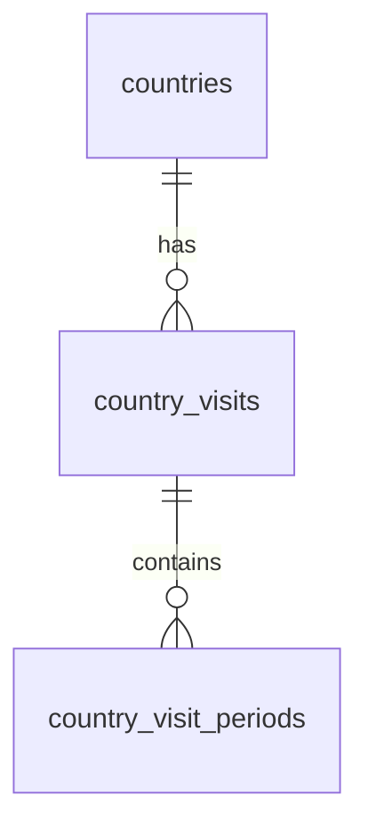

# Country history design and rollout

The earlier country implementation loaded two CSVs at build time; Supabase
contained only cities and editor permissions. One arrival/departure pair could
not express merged visits without counting time spent elsewhere.

This change adds three related tables, leaving city records and editor identity
unchanged:

- **countries**: stable code, name, continent, 195 membership (nullable for
  retained territories), visit status, original first-visit order, nullable
  reported lifetime counts/days, completeness, aliases and source notes.
- **country_visits**: composite key `(country_code,visit_number)`, bounds with
  their original date precision, nullable duration and notes. Six known visits
  remain undated. A counted visit can contain several actual stays.
- **country_visit_periods**: composite key adding `period_number`, exact local
  arrival/departure dates, source references and notes. Inclusive day sums
  exclude gaps. There are no timestamps/timezone conversions for stay dates.

Recorded totals are calculated from actual stays, while reported lifetime
values remain separate and nullable. The CSV overview includes recorded totals
as validation checks; they are not duplicated as editable database fields.
Country visits never change a city's visit or map-progress status. No city
foreign key is imposed on territory codes, preserving existing collection data.

## Integrity and permissions

Foreign keys prevent orphaned periods. Deferred constraint triggers validate the
final transaction, permitting a visit and its child periods to be updated
atomically. They reject overlap, reversed/invalid dates, nonconsecutive numbering,
bounds/duration mismatches, invalid 14-day grouping and contradictory lifetime
totals. Both client and importer also validate actual periods and totals.

Public visitors can read. Authenticated users can write only when the existing
`atlas_can_edit()` check approves them. Stable identifiers and country metadata
cannot be changed by browser roles. The snapshot RPC is security-invoker and
uses the caller's read permissions; it does not expose private editors.

The country panel uses `atlas_country_snapshot()` to read all related tables
in one statement. It refreshes on focus and every 30 seconds while visible.
A failed/incomplete/invalid snapshot retains the last available data with a
visible retry notice. City saving remains independent of country refreshes.

## Prepare and apply

1. Regenerate and verify the CSVs, then run `npm run country:prepare`.
   This writes `.cache/country-history-ready.sql` without remote changes.
2. Run `npm test`, `npm run build`, `npm run test:browser`, and
   `npm run test:cloud`. Database tests use real PostgreSQL through PGlite;
   browser tests cover database reads, fallback/recovery, actual stay display,
   the corrected UK dates, ranks, city editing and mobile layouts.
3. `npm run country:verify-live` tests the full migration/import on the real
   Supabase server and rolls it back. Confirm the new tables are absent afterwards.
4. `npm run country:apply` applies the reviewed additive migration and initial
   seed to the configured Supabase project, in one transaction under an advisory
   lock. It uses the existing scoped management credential. It sends no email,
   changes no auth configuration and never writes to cities.
5. Check the public snapshot, permissions, all country/visit/period rows and
   source dates before deploying the website code. Preserve a pre-apply city
   snapshot hash and compare it afterwards.

The initial importer uses insert-on-conflict-do-nothing plus a full equality
check. A repeat identical import is a no-op. Differing pre-existing data causes
rollback with an export/review error rather than overwriting user edits.
Future country-history editing should use one transaction for related rows and
review exported data before replacing a dataset.

Apply the additive database change before the website release. The previous
website ignores the new tables, so it remains compatible. The bundled corrected
snapshot supplies fallback data to the new website. Environment publication,
website deployment and database migration are separate actions.

## Verified source

See `data/sources/yearbook-provenance.json` and
`data/templates/COUNTRY-VISITS.md`. Current totals: 198 database country/territory
rows (197 canonical plus existing Svalbard), 120 visit rows (114 dated + six
undated), 125 actual stays and 270 country-days. There are 98 known visited
countries; 92 have dated yearbook records. Lifetime ordering and unknown lifetime
totals are retained. The 21 July 2025 Malaysia flag ambiguity remains documented.

## Validation recorded for this change

The migration and country data have been applied to the configured Supabase
project. The website release has not been deployed. See
[country-history-validation.json](country-history-validation.json) for the
verified counts, exact-row/source-date comparisons, unchanged city hash,
permission checks, build checks and test results. All 50 unit/database tests,
21 static-browser tests and 31 cloud-browser tests passed.

The database-configured production build was also checked against actual
Supabase API responses for Australia, New Zealand, the UK and Bosnia, including
a 320px layout. This cloud environment's Chrome cannot directly trust its
HTTPS inspection certificate, so that check forwarded API requests through
Node's managed proxy and trusted CA, with TLS verification retained. It did
not substitute fixture data or disable certificate verification.
